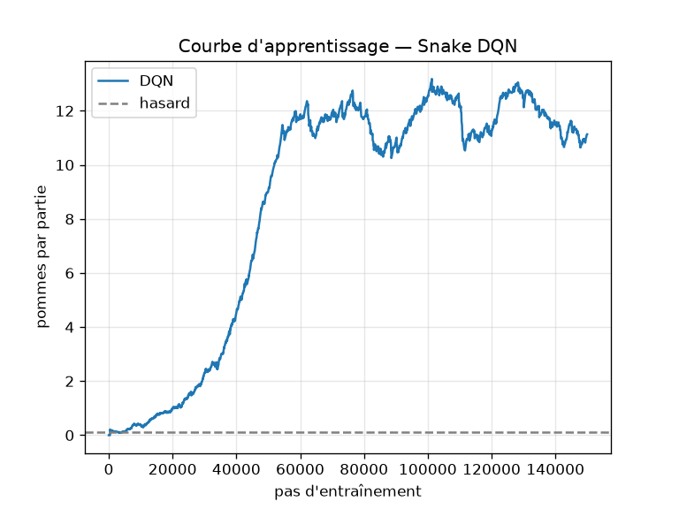

# Projet RL — Snake (DQN, Stable-Baselines3)

```bash
python3.11 -m venv .venv && .venv/bin/pip install -r requirements.txt
.venv/bin/python jeu_snake_squelette.py
```
- 1er lancement : entraînement (~1 min) → `snake_dqn.zip`, `courbe.png`, score comparé au hasard, puis démo.
- Lancements suivants : charge `snake_dqn.zip` et lance directement la démo. Supprimez ce fichier pour ré-entraîner.

## Le MDP
- **État** (11 variables 0/1) : danger devant, à droite et à gauche · direction actuelle (4) · pomme à gauche, à droite, en haut, en bas.
- **Actions** (3, relatives) : tout droit, tourner à droite, tourner à gauche. Le demi-tour est impossible par construction.
- **Récompense** : +10 quand il mange une pomme · −10 quand il meurt · −0,01 par pas, pour qu'il ne tourne pas en rond.
- **Fin d'épisode** : à la mort, ou après 100 × longueur pas (anti-boucle infinie).
- **Algo** : DQN (actions discrètes + petit vecteur d'état), lr 1e-3, γ 0.9, ε 1 → 0.05 sur 30 % de l'entraînement, 150k pas.

## Résultats
Agent DQN : **19,3 pommes en moyenne (max 37)** sur 50 parties, contre **0,14** pour le hasard.



Lors d'essais complémentaires (même code, 100 parties) :

| variante | pommes en moyenne |
|---|---|
| sans pénalité par pas (+10/−10/0) | 18,0 |
| γ = 0.99 au lieu de 0.9 | 20,1 |
| + bonus ±0,1 si l'agent se rapproche ou s'éloigne de la pomme | 19,1 |
| + 6 capteurs (danger à 2 cases, cases libres atteignables) | 31,5 |

→ La limite principale vient de l'état : l'agent ne voit pas qu'il s'enferme dans son propre corps.
