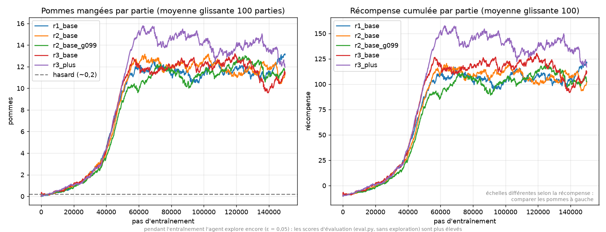

# Projet RL — Snake (DQN, Stable-Baselines3)

## Installation
```bash
python3.11 -m venv .venv && .venv/bin/pip install -r requirements.txt
```

## Fichiers
| fichier | rôle |
|---|---|
| `jeu_snake_squelette.py` | squelette du cours, TODO complétés (version R2, tout-en-un) |
| `snake_env.py` | env Gymnasium paramétrable : `reward_mode` (r1/r2/r3), `obs_mode` (base/plus) |
| `train.py` | entraîne un DQN → `models/<nom>.zip` + `logs/<nom>.monitor.csv` |
| `eval.py` | compare chaque modèle au hasard sur 100 parties → `results.md` |
| `plot.py` | courbes d'apprentissage → `courbes.png` |
| `demo.py` | regarder jouer un modèle sauvegardé (`--gif` pour une vidéo de secours) |

## Commandes
```bash
.venv/bin/python train.py --reward r3 --obs plus      # ~3-5 min
.venv/bin/python eval.py
.venv/bin/python plot.py
.venv/bin/python demo.py r3_plus
.venv/bin/python demo.py r3_plus --gif demo.gif --parties 2
```

## Le MDP
- **État** : 11 capteurs 0/1 (version `base`) : danger devant, à droite et à gauche · direction (4) · pomme à gauche, à droite, en haut, en bas.
  La version `plus` ajoute 6 capteurs (17 en tout) : danger à 2 cases devant, à droite et à gauche, et **part des cases libres atteignables** (flood fill) si l'on va devant, à droite ou à gauche. Avec ces capteurs, l'agent voit qu'un virage l'enferme dans son corps.
- **Actions** : 3 actions relatives : tout droit, tourner à droite, tourner à gauche. Le demi-tour (suicide immédiat) est impossible par construction.
- **Récompense** (variantes comparées) :

| variante | pomme | mort | pas normal | shaping |
|---|---|---|---|---|
| R1 | +10 | −10 | 0 | — |
| R2 | +10 | −10 | −0,01 | — |
| R3 | +10 | −10 | −0,01 | +0,1 si on se rapproche de la pomme, −0,1 sinon |

- **Fin d'épisode** : mort (épisode *terminé*), ou plus de 100 × longueur pas joués (*tronqué*), pour éviter les boucles infinies.
- **Algorithme** : DQN, adapté à des actions discrètes et à un petit vecteur d'état. MLP par défaut de SB3 (64-64), lr 1e-3, γ 0.9, buffer 100k, ε : 1 → 0.05 sur 30 % de l'entraînement, réseau cible mis à jour tous les 500 pas.

## Résultats (150 000 pas par modèle, 100 parties d'évaluation)
| modèle | récompense | obs / γ | pommes (moy. ± écart-type) | max | ≥10 pommes |
|---|---|---|---|---|---|
| hasard | - | - | 0,1 ± 0,3 | 1 | 0 % |
| r1_base | R1 | base, γ=0.9 | 18,0 ± 5,7 | 32 | 92 % |
| r2_base | R2 | base, γ=0.9 | 22,9 ± 7,9 | 41 | 97 % |
| r2_base_g099 | R2 | base, γ=0.99 | 20,1 ± 7,4 | 41 | 94 % |
| r3_base | R3 | base, γ=0.9 | 19,1 ± 6,8 | 40 | 93 % |
| **r3_plus** | R3 | **plus**, γ=0.9 | **31,5 ± 10,0** | **58** | 98 % |



### Analyse
- Tous les agents **écrasent le hasard** (0,1 → 18 à 31 pommes). Le gros de l'apprentissage se fait entre 30k et 60k pas, puis la courbe plafonne.
- **R1 → R2** : la petite pénalité par pas (−0,01) pousse l'agent à aller droit à la pomme au lieu de tourner en rond (+5 pommes).
- **R3 (shaping distance)** : il apprend aussi vite mais ne fait pas mieux que R2 avec l'observation de base. Le shaping aide à trouver la pomme, mais ce n'est pas ce qui limite l'agent.
- **γ = 0.99** : légèrement moins bon et plus lent. Avec des capteurs aussi locaux, regarder loin dans le futur n'apporte rien : l'agent ne peut de toute façon pas planifier.
- **La vraie limite, c'est l'état** : avec 11 capteurs, l'agent meurt en s'enfermant dans son propre corps, qu'il ne voit pas. Avec les 6 capteurs `plus` (flood fill), il voit les impasses : **+38 % de pommes** (31,5 en moyenne, jusqu'à 58).
- Les scores d'entraînement (courbe) sont plus bas que ceux de l'évaluation, parce que l'agent explore encore (ε = 0,05) pendant l'entraînement.

### Limites et pistes
- Un seul seed par configuration : les écarts de ±2 pommes (R1/R3/γ) ne sont pas forcément significatifs. Il faudrait 3 seeds par variante.
- La courbe de r3_plus redescend en fin d'entraînement (oubli catastrophique classique du DQN). On pourrait garder le meilleur checkpoint avec `EvalCallback`.
- Bonus possible : observation en pixels avec un CNN (`CnnPolicy`), ou une grille plus grande.
